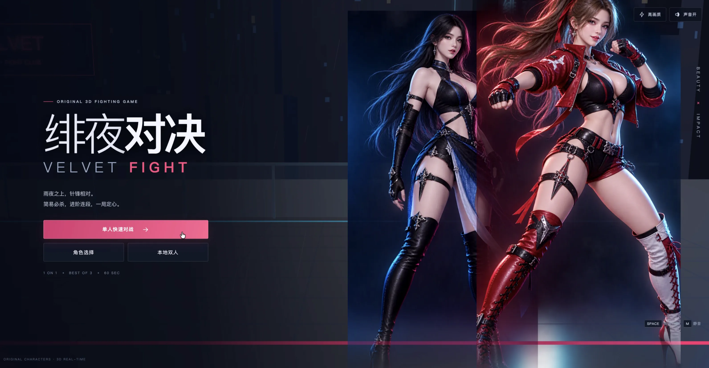

# moonlight-fighter · 绯夜对决

原创 3D 美少女 2.5D 格斗游戏：尹世琳与姜艺娜在雨夜首尔高空会所天台展开一对一、三局两胜的对决。



## 线上试玩

**<https://wangjunjian.com/moonlight-fighter/>**

纯前端、零后端依赖，可直接在浏览器里开打。站点由 GitHub Actions 在每次 push 到 `main` 时重新构建并发布到 GitHub Pages（见 `.github/workflows/pages.yml`），构建产物不入库。

## 项目结构

```
moonlight-fighter/
└── app/                  # 游戏应用（Vite + React + Three.js）
    ├── public/           # 角色立绘与高精 GLB 模型等资源
    ├── scripts/          # 构建产物检查与 Playwright 验证脚本
    ├── src/
    │   ├── game/         # 战斗引擎：engine / combat / characters / effects / audio 等
    │   └── pages/        # React 页面外壳
    ├── Dockerfile        # 生产构建镜像
    └── package.json
```

## 本地运行

```bash
cd app
npm install
npm run dev
```

其他常用命令：

| 命令 | 作用 |
|---|---|
| `npm run build` | 类型检查 + 生产构建到 `app/dist/` |
| `npm run preview` | 本地预览生产构建 |
| `npm run check` | 仅运行 TypeScript 类型检查 |
| `npm run verify` | Playwright 自动化验证游戏流程 |
| `npm run verify:pages` | 模拟 Pages 子路径部署，验证 `/moonlight-fighter/` 下不白屏 |

Docker 部署：`docker build -t moonlight-fighter app/` 后运行镜像即可（80 端口）。

> 部署在 Pages 项目站点时，页面挂在子路径下而不是站点根目录。`app/src/main.tsx` 会根据文档 URL 推导 `BrowserRouter` 的 basename，本地、Docker、Pages 三种环境共用同一份产物；改动路由或部署方式后请跑 `npm run verify:pages`。

## 操作方式

| 功能 | 玩家 1 | 玩家 2 |
|---|---|---|
| 移动 / 跳跃 / 蹲伏 | W A S D | 方向键 |
| 轻攻击 | J | 小键盘 1 |
| 重攻击 | K | 小键盘 2 |
| 特殊技 | L | 小键盘 3 |
| 投技 | U | 小键盘 4 |
| 超必杀（满能量） | I | 小键盘 5 |
| 冲刺 | 快速双击 A / D | 快速双击左右方向键 |

- 后拉防御；投技不可防御。
- 特殊技配合上方向为对空技，配合左右或下方向为突进技。
- 轻攻击命中后可取消接重攻击或特殊技；连段伤害会递减。
- 空格快速开始 / 确认，Esc 暂停，M 静音。

## 技术要点

- Three.js + TypeScript + React 外壳，60 Hz 固定步长战斗逻辑。
- 实例化城市背景与粒子特效，高精 GLB 角色加载与程序化姿态动画（加载失败时回退程序化关节模型）。
- Web Audio 合成音乐与音效，全部资源本地化，无在线服务依赖。
- 模式：单人对 AI（简单 / 标准 / 困难）与本地双人；60 秒回合、三局两胜。

更多设计与实现细节见 [app/info.md](app/info.md)。
